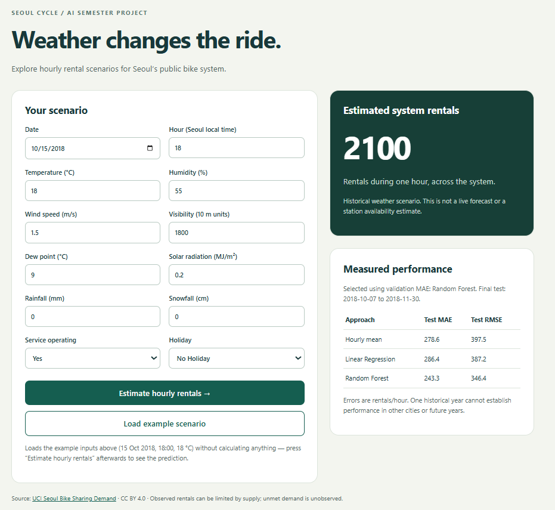
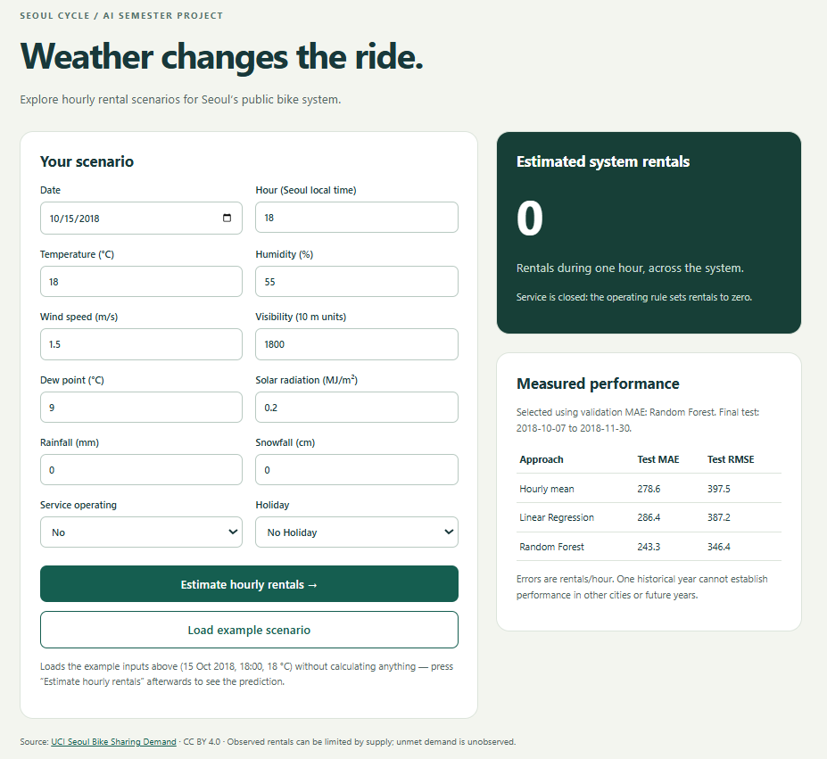
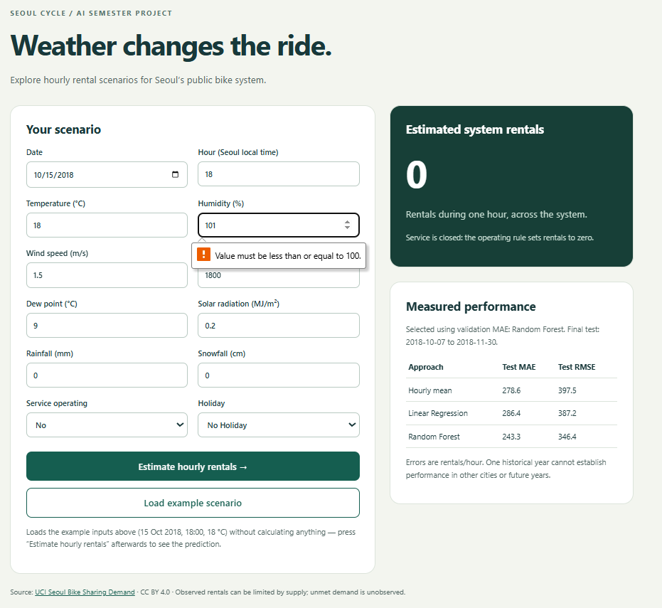

# Weather-Aware Bike Rental Demand Prediction

Predict the **total number of bikes rented across Seoul's public bike-sharing
system in one hour**, from the hour, calendar, weather, holiday, and
operating information. A regression project for the Artificial Intelligence
semester project (Riphah International University, BSAI Fall 2026, due
21 December 2026).

> **Prototype, trained on Seoul historical data (Dec 2017 – Nov 2018).**
> It estimates rentals for a *weather scenario you type in* — it is not a
> live forecast, not a station-availability predictor, and it does not
> measure unmet demand. It must not be claimed to work for Pakistani cities
> without local data and validation.

## Measured results (real runs, 15 Nov 2026)

Chronological splits — train 1 Dec 2017 – 13 Aug 2018 (6,132 h),
validation 13 Aug – 6 Oct 2018 (1,308 h), final test 7 Oct – 30 Nov 2018
(1,320 h). Model chosen on **validation MAE only**, before looking at test.

| Model | Validation MAE | Validation RMSE | Test MAE | Test RMSE | Fit time |
|---|---:|---:|---:|---:|---:|
| Hourly-mean baseline | 420.3 | 566.3 | 278.6 | 397.5 | <0.01 s |
| Linear Regression | 302.2 | 422.9 | 286.4 | 387.2 | 0.06 s |
| **Random Forest (selected)** | **162.2** | **250.9** | **243.3** | **346.4** | 2.98 s |

Errors are rentals/hour. Fit times are from `reports/metrics.json` (the
regenerated run); a fresh-environment re-run gave 0.10 s and 6.9 s for the
same two fits, so treat timings as approximate — they vary between runs
and machines. On operating hours only, the selected Random Forest scores
test MAE 262.4 / RMSE 359.7. Peak hours (07–09, 17–19) are much harder:
test MAE 482.3 (n = 306) vs 189.1 off-peak (n = 918). The test period is
autumn-only and the training period contains **no autumn at all**, so the
model under-predicts test operating hours by 233 rentals/hour on average
— see § Limitations in the technical report. Full numbers:
`reports/metrics.json`, `reports/test_predictions.csv`.

These results were reproduced exactly (same MAE/RMSE to four decimal
places, same dataset SHA-256) in a fresh virtual environment with the
pinned dependencies below, after deleting the data, model, and reports
and regenerating everything from source.

## Quick start (Windows PowerShell)

Run each command separately, in order, from the project folder:

```powershell
python -m venv .venv
.\.venv\Scripts\Activate.ps1
pip install -r requirements.txt
```

If PowerShell blocks the activation script, run this first (it applies to
the current window only):

```powershell
Set-ExecutionPolicy -Scope Process -ExecutionPolicy Bypass
```

Then run the pipeline, one command at a time:

```powershell
python -m bike.eda
python -m bike.train
python -m pytest tests/ -q
python -m bike.app
```

After training, open http://127.0.0.1:5000/ in a browser.

The GitHub repository excludes the downloaded dataset and trained model.
On a fresh clone, run bike.eda and bike.train before starting bike.app.
The dataset downloads automatically when it is missing. Training creates
artifacts/model.joblib and regenerates the evaluation reports.

On Linux or macOS, replace the activation line with:

```bash
source .venv/bin/activate
```

Python 3.12+ is required.

### Exact tested dependency versions

`requirements.txt` pins these (installed and verified 15 Nov 2026):

| Package | Version |
|---|---|
| Flask | 3.1.3 |
| joblib | 1.6.0 |
| matplotlib | 3.11.2 |
| numpy | 2.5.4 |
| pandas | 2.3.3 |
| pytest | 9.2.0 |
| scikit-learn | 1.9.1 |

## Dataset

Seoul Bike Sharing Demand, UCI Machine Learning Repository, dataset 560 —
https://archive.ics.uci.edu/dataset/560/seoul+bike+sharing+demand

- 8,760 hourly records, 1 Dec 2017 00:00 – 30 Nov 2018 23:00, complete
  hourly sequence, **0 missing cells**, 295 non-operating hours (all with
  0 rentals). SHA-256 of the downloaded CSV:
  `373339b71a8935d69e9af0abf26a70744632119862eeb3919efb389a7b749c60`
- Target: `Rented Bike Count`. It is never used as an input.
- Citation: Seoul Bike Sharing Demand [Dataset]. (2020). UCI Machine
  Learning Repository. https://doi.org/10.24432/C5F62R
- License: CC BY 4.0.

`bike/data.py` downloads the official ZIP, checks the **original column
names and their order** before renaming anything, then checks the 8,760-row
complete hourly sequence, duplicates, missing values, operating flags,
and non-negative rentals, and raises an error if any check fails. No
missing values were invented or imputed to demonstrate cleaning — there
were none to clean.

## How prediction works

1. **Features** — 8 weather measurements, hour encoded both as a category
   and as sin/cos (so 23:00 and 00:00 are neighbours), weekday, month,
   season, holiday. Season and weekday/month are derived from the date
   you enter; nothing is derived from the target.
2. **Preprocessing** (one shared `ColumnTransformer`, fitted on training
   data only): median imputation + standard scaling for numbers,
   one-hot encoding for calendar categories.
3. **Closure rule** — if the service is not operating, the prediction is
   exactly 0, matching the data (all 295 closed hours have 0 rentals).
   Otherwise negative predictions are clipped to 0.
4. The Flask app loads the saved pipeline from `artifacts/model.joblib`
   once at startup; it never retrains per prediction.

## The web interface

The page shows "—" in the prediction panel until a scenario is submitted;
that is the intended empty state, not an error. Fill in a scenario (or
press **Load example scenario**, which fills in the documented example —
15 Oct 2018, 18:00, 18 °C, 55% humidity — without calculating anything),
then press **Estimate hourly rentals**. Submitted values stay visible
after a prediction or a validation error.

## Project structure

```
bike/
  data.py    dataset download, schema/sequence checks, calendar features
  eda.py     exploratory analysis -> reports/eda_*.png, eda_summary.json
  model.py   shared preprocessing, the three candidate models, closure rule
  train.py   chronological experiment, validation selection, reports/metrics.json
  app.py     Flask scenario interface (loads the saved model)
templates/index.html   the web form and results page
tests/test_project.py  21 tests: splits, column validation, validation,
                       closure, app, saved model, example scenario
reports/     EDA charts, evaluation charts, metrics.json, test_predictions.csv
artifacts/model.joblib  saved selected model (regenerated by bike.train)
docs/Technical-Report.md   full report: method, results, trade-offs, ethics
```

## Documentation

- **Technical report:** `docs/Technical-Report.md` — problem, objectives,
  requirements, assumptions, constraints, dataset justification,
  preprocessing, model design, evaluation, trade-offs, ethics,
  limitations, future work, and a run log distinguishing the initial
  results from the independent fresh-environment reproduction.
- **Verification (this machine, 15 Nov 2026, fresh environment with
  pinned dependencies):** dataset checks passed; EDA and training ran
  end-to-end and reproduced the earlier metrics exactly; **21/21 tests
  passed**; live Flask smoke check passed — GET `/` returned 200 with
  the "No estimate yet" empty state, the example button loaded inputs
  without calculating, the default scenario predicted **2,100** rentals,
  a changed scenario (08:00, 30 °C) predicted **1,219**, a closed-service
  scenario returned **0**, and humidity 101 was rejected with an error
  message while keeping the submitted value visible.
- **Not yet verified interactively in a real browser:** the checks above
  use the Flask test client and `curl` against the live local server.
  Opening http://127.0.0.1:5000/ in a browser on your own laptop and
  pressing the buttons once is the remaining manual check.

## GitHub

This repository is GitHub-ready (`.gitignore` excludes the virtual
environment, the downloaded CSV, and the 37 MB model file, which is
regenerated by training). Do **not** push or publish without the author's
explicit authorization.

## Application preview

### Rental estimate


### Closed service


### Input validation
